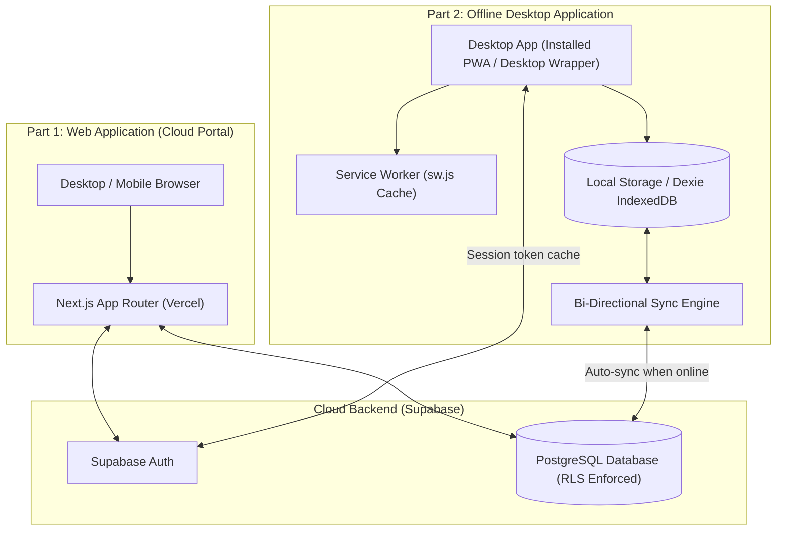
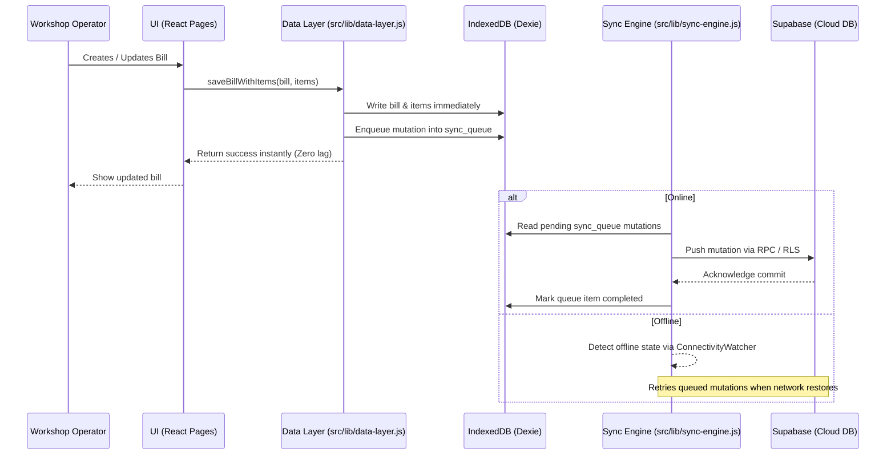

# System Architecture & Two-Part Application Design

This document details the multi-platform architecture of the **Shree Royal Car Business Management System (BMS)**.

The system is designed in **two complementary parts**:
1. **The Web Application (Cloud Portal)** — Accessible anywhere via web browser, hosted on Vercel/Node.js, communicating directly with Supabase.
2. **The Offline-Compatible Desktop App** — Runs locally on desktop machines (even without an internet connection), stores data locally in IndexedDB, and automatically syncs changes when online.

---

## 🏗️ Architecture Overview



---

## 🌐 Part 1: The Web Application (Cloud Portal)

The web application is built with **Next.js 16 (App Router)** and styled with **Tailwind CSS**.

### Key Characteristics:
- **Server and Client Rendering**: Pages render responsive interfaces for managing customers, vehicles, invoices, finance, and workers.
- **Direct Cloud Connectivity**: Authenticates directly with Supabase Auth and queries PostgreSQL via Row Level Security (RLS) policies.
- **REST / API Routes**:
  - `/api/health`: Health check and uptime monitoring.

---

## 💻 Part 2: Offline-Compatible Desktop Application

Auto repair shops frequently experience intermittent or zero internet connectivity. The desktop experience functions uninterrupted when offline.

### How Offline Compatibility Works:



### Core Offline Components:
1. **Unified Data Layer (`src/lib/data-layer.js`)**:
   - Single abstraction point used by all pages (`billing`, `customers`, `finance`, `workers`, `profile`).
   - Automatically writes to IndexedDB first and enqueues sync tasks.
   - Transparent in-memory caching coalesces concurrent reads.
2. **Local Database (`src/lib/local-db.js`)**:
   - Powered by **Dexie.js** (IndexedDB).
   - Stores tables: `customers`, `vehicles`, `bills`, `bill_items`, `workers`, `salary_records`, `sync_queue`, and `sync_meta`.
3. **Bi-Directional Sync Engine (`src/lib/sync-engine.js`)**:
   - Continuously monitors network health (`navigator.onLine` + lightweight probe ping).
   - Flushes offline queue on reconnect and pulls latest cloud delta updates.
   - Broadcasts `src-bms:reconnected` events to trigger automatic UI refreshes via `useReconnectReload`.
4. **Service Worker (`public/sw.js`)**:
   - Pre-caches Next.js static asset chunks and app shell navigation pages.
   - Enables full offline reloads and app boot without an internet connection.

---

## 📦 Desktop Packaging Options

To run the offline application as a desktop app, two pathways exist:

### Approach A: Progressive Web App (PWA) Desktop Installation (Built-in)
- **Status**: Ready to use.
- **How it works**: Open the app in Microsoft Edge, Google Chrome, or Brave. Click the **Install** button in the URL bar (or Menu > "Install Shree Royal Car").
- **Benefits**:
  - Launches in an independent window without browser navigation buttons.
  - Pinned to Windows Taskbar and Start Menu.
  - Automatically updates when connected.
  - Zero additional executable download required.

### Approach B: Native Desktop Wrapper (Electron)
- **Status**: Optional extension.
- **How it works**: Package the frontend inside an **Electron** shell (`electron/main.js`).
- **Benefits**:
  - Bundled as a standalone `.exe` installer.
  - Native Windows system integration.

---

## 📂 Navigation & Code Organization

```
Business-Management-System/
├── src/
│   ├── app/                    # Next.js App Router (Pages & API routes)
│   │   ├── billing/            # Invoice creation & history
│   │   ├── customers/          # Customer & vehicle records
│   │   ├── finance/            # Revenue & analytics charts
│   │   ├── workers/            # Worker payroll & attendance
│   │   ├── profile/            # Workshop profile & bank details
│   │   └── api/                # Cloud endpoints (health checks)
│   ├── components/             # Reusable UI & Layout components
│   ├── context/                # AuthContext & SyncContext providers
│   ├── hooks/                  # Custom React hooks (e.g. useReconnectReload)
│   └── lib/                    # Core business logic:
│       ├── data-layer.js       # Unified data access (offline-first switch)
│       ├── local-db.js         # IndexedDB schema (Dexie)
│       ├── local-repo.js       # Local CRUD database operations
│       ├── sync-engine.js      # Bi-directional sync engine
│       ├── supabase.js         # Supabase client & auth helpers
│       └── helpers.js          # Formatting & normalization helpers
├── public/                     # Static assets (logo, favicon, Service Worker)
├── supabase/                   # PostgreSQL schemas, RLS policies, RPC migrations
├── docs/                       # Comprehensive documentation & setup guides
└── scripts/                    # Pre-cache & build automation scripts
```
